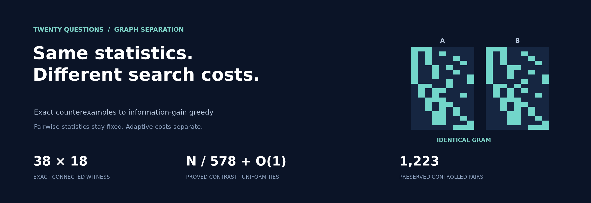
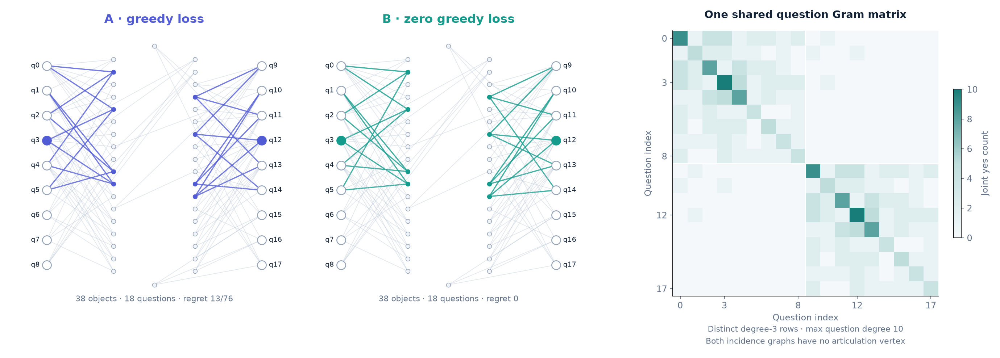
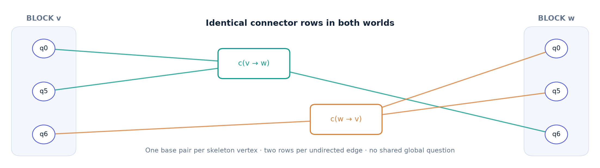
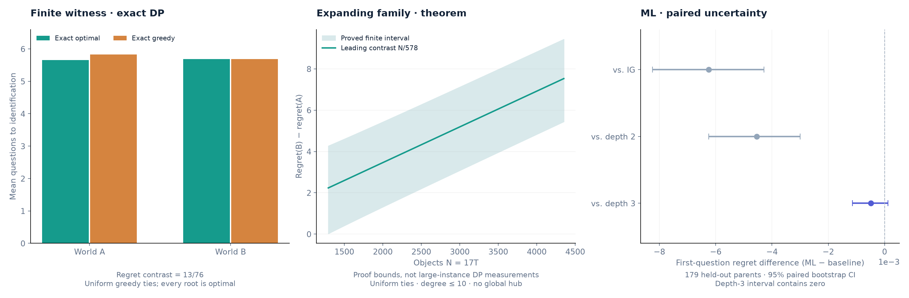

<p align="center">
  
</p>

<p align="center">
  <a href="research/output/pdf/Twenty_Questions_Paper_Final.pdf"><b>Read the paper</b></a> ·
  <a href="research/paper/main.tex">LaTeX</a> ·
  <a href="docs/REPRODUCIBILITY.md">Reproduce</a> ·
  <a href="docs/README.ko.md">한국어</a>
</p>

<p align="center">
  <a href="https://github.com/gjtjwns06-ui/twenty-questions-graph-separation/actions/workflows/research-checks.yml"></a>
  
  
</p>

# Twenty Questions · Graph Separation

**Can two knowledge graphs agree on every pair of questions, yet make information-gain greedy search behave differently?**

This research constructs such pairs, searches for finite counterexamples, and proves a growing separation in actual identification cost. The repository contains the manuscript, exact response tables, frozen experiments, independent checks, and the unsuccessful attempts that shaped the final construction.

| Fixed across each pair | Allowed to change | What we evaluate |
| :--- | :--- | :--- |
| Number of objects and questions | Higher-order response structure | Exact optimal identification cost |
| Three attributes per object | Conditional structure after answers | Full information-gain greedy cost |
| Every indexed question-pair count, including marginals | Adaptive decision trees | First-question regret, reported separately |

The hidden object is uniform, answers are noiseless and binary, and every question has unit cost. Greedy chooses uniformly among maximum-information questions **at every state**.

## A concrete counterexample



Large nodes are questions; small nodes are objects. Colored small nodes and their edges mark the traded rows. Filled question nodes are the initial greedy choices, `q3` and `q12` in both worlds. The right panel is the common matrix $M_A^\top M_A=M_B^\top M_B$.

Both graphs are connected, have **no articulation vertex**, and have maximum question degree 10. Every object has three distinct yes attributes. All initial greedy questions are optimal first actions—yet later greedy decisions lose in world A.

| Exact quantity | World A | World B |
| :--- | ---: | ---: |
| Objects / questions | 38 / 18 | 38 / 18 |
| Optimal mean cost | 215/38 | 216/38 |
| Uniform-tie greedy mean cost | 443/76 | 108/19 |
| Full-policy greedy regret | **13/76** | **0** |
| Minimum regret over greedy tie resolutions | **3/19** | **0** |

[Saved response rows and costs](research/runs/hubfree_search_v1/best.json) · [Independent certificate](research/runs/final_independent_certificate_v1/summary.json) · [Rerun the exact calculation](scripts/verify_finite38.py)

## From one witness to an expanding family



A different 14-object base pair is placed at each vertex of a connected cubic skeleton. Two identical connector rows per edge join the copies. On an expander skeleton, the resulting incidence graphs retain positive expansion, degree-three objects, identical indexed Gram matrices, maximum question degree 10, and no articulation vertex.

For infinitely many sizes $N=17T$, let $R(M)=C_{\mathrm{IG}}(M)-C^\star(M)$. Under uniform greedy ties,

$$R(B_T)-R(A_T)=\frac{N}{578}+O(1).$$

The optimal leading cost is $35T/34$ in both worlds; greedy leading costs are $71T/68$ and $73T/68$. The limiting approximation ratios are $71/70$ and $73/70$. The additive contrast grows linearly; the theorem's tie assumption is essential.

[Construction and proof](research/paper/main.tex) · [Exact expander certificates](research/runs/hubfree_expander_cert_v1/summary.json) · [Claim boundaries](docs/RESULTS_AND_SCOPE.md)

## Results, with uncertainty intact



The three panels represent different kinds of evidence: **finite exact computation**, **proved bounds**, and **held-out statistical comparisons**. The large-family band is a theorem interval, not a measured large-instance DP curve.

| Preserved study | Recorded outcome |
| :--- | :--- |
| Synthetic generation | 1,400 parent attempts → **1,223 controlled pairs / 2,446 worlds** |
| Pairs with zero optimal-cost effect | **1,114**, retained in the denominator |
| Fixed-Gram extremal search | 2,534 worlds; best contrast **2/21**, without improving the seed |
| Common-background design | 6,000 proposals; selected 18×9 contrast **2/9** |
| Hub-free search | 240 port patterns / 720 worlds; selected 38×18 contrast **13/76** |
| Primary ML comparison | 179 held-out parents; improvement over depth-3 **not established** |

The preselected boosting model had first-question regret `0.001435`, versus `0.001920` for depth-3 lookahead. Their paired difference was `−0.000485`, with 95% interval **[−0.001144, +0.000116]**. That interval includes zero. All 13 methods/ablations remain in the results; the ML full sequential policy was not evaluated.

Failed amplifications, zero-contrast small cases, and resource-limited incomplete calculations are retained. See [the full results and limitations](docs/RESULTS_AND_SCOPE.md) and [raw comparison table](research/runs/main/report/paired_comparisons.csv).

## Quick start

The original measurements used Windows and Python 3.13.5. These commands use PowerShell; activation and POSIX equivalents are in the [reproducibility guide](docs/REPRODUCIBILITY.md).

```powershell
git clone https://github.com/gjtjwns06-ui/twenty-questions-graph-separation.git
cd twenty-questions-graph-separation

# Standard library only: verify files and lossless archives.
python scripts/verify_release.py

python -m venv .venv
.\.venv\Scripts\python.exe -m pip install -r research/requirements-lock.txt

# Reproduce the original 14×8 witness and the final finite 38×18 witness.
.\.venv\Scripts\python.exe research/verify_witness.py --output witness14_recomputed.json
.\.venv\Scripts\python.exe scripts/verify_finite38.py
```

Large JSONL/CSV files are losslessly compressed in `data/archives/`: **189 MB → 15.7 MB**. Their original SHA-256 hashes are preserved. To restore the recorded raw dataset before regenerating reports:

```powershell
python scripts/restore_data.py
```

The solver checks and figure generator are also directly runnable:

```powershell
Push-Location research
..\.venv\Scripts\python.exe -m unittest discover -s tests -v
Pop-Location
.\.venv\Scripts\python.exe scripts/make_assets.py
```

No LLM API, API key, or paid inference is required.

## Repository map

```text
assets/                    README figures + their data provenance
docs/                      Korean overview, reproduction, results and scope
scripts/                   Archive verification, restore, exact witness, figures
research/                  Preserved research workspace
  tq/                      Generator, Pasch trades, exact DP, features, models
  configs/                 Frozen pilot, main and extremal configurations
  runs/                    Original worlds, certificates, summaries and reports
  final_work/              Hub-free construction and independent certificates
  paper/                   Complete self-contained XeLaTeX manuscript
  output/pdf/              Final 18-page paper
data/archives/             Losslessly compressed large raw files
publication-manifest.json  Original/stored hashes and declared omissions
```

The original workspace lives under `research/` so its source files, archived READMEs and frozen records keep their original relative paths and bytes. Downloaded third-party full texts, raw search excerpts and local browser/debug receipts are excluded from the public copy; the [publication manifest](publication-manifest.json) declares every omission. Source URLs, hashes and authored literature reviews remain available. The public integrity check reports omitted records explicitly.

## Paper and citation

**Linear Separation of Information-Gain Greedy Regret under Identical Pairwise Statistics**  
Seojun Heo · 2026 · Korean manuscript with English title and abstract

[Paper PDF](research/output/pdf/Twenty_Questions_Paper_Final.pdf) · [Self-contained LaTeX](research/paper/main.tex) · [LaTeX package](research/paper/Twenty_Questions_LaTeX.zip) · [Citation metadata](CITATION.cff)

The contribution is the simultaneous constrained construction and its adaptive cost analysis. The literature review does not certify priority or the absence of every possible prior reduction. See the [recorded novelty decision](research/reports/novelty/NOVELTY_DECISION.md).
