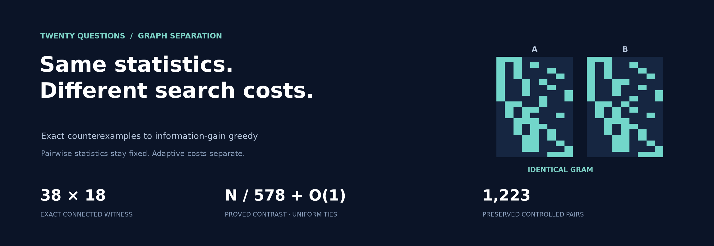
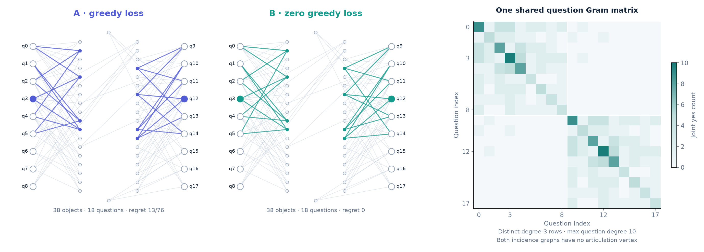
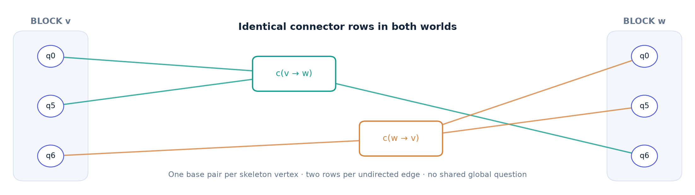
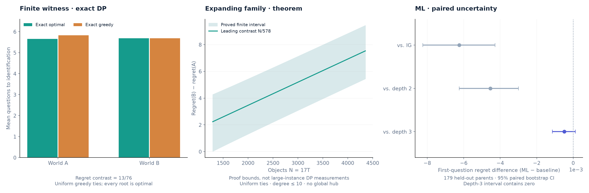

[English overview](../README.md) · [재현 안내](REPRODUCIBILITY.md) · [결과와 주장 범위](RESULTS_AND_SCOPE.md)

# 스무고개 · 질문 쌍 통계를 보존하는 그래프 분리

> **질문 하나하나의 빈도와 모든 질문 쌍의 공동 출현 수가 같아도, 정보이득 탐욕 전략의 실제 식별 비용은 달라질 수 있을까?**

이 저장소는 그 차이를 직접 만드는 연구의 코드·논문·실험 자료다. 무작위 생성으로 시작해 극값 탐색으로 반례를 찾고, 중심 질문에 의존하지 않는 연결 그래프 가족으로 확장했다.

## 핵심 반례를 먼저 보기

큰 정점은 질문, 작은 정점은 대상이다. 색칠한 작은 정점은 교환된 행, 색칠한 질문은 처음에 정보이득이 최대인 `q3`, `q12`다. 두 그래프는 단절점 없이 연결되어 있고 최대 질문 차수는 10이다. 모든 대상은 정확히 세 질문에 yes라고 답한다.

두 세계의 모든 질문 쌍 통계가 같지만, **A의 탐욕 손실은 13/76, B는 0**이다. 최초 탐욕 질문은 양쪽 모두 최적 첫 질문이다. 따라서 이 손실은 첫 질문 선택 이후에도 발생한다. A에서 탐욕 동점을 가장 유리하게 처리해도 손실 3/19가 남는다.

## 크기가 커져도 유지되는 차이

증폭에는 유한 38대상 반례와 구별되는 14대상 기반 쌍을 사용한다. cubic 골격의 각 정점에 기반을 놓고 간선마다 같은 연결 대상 두 개를 추가한다. 팽창 골격을 쓰면 전체 이분 그래프도 양의 팽창을 갖는다.

동일한 질문 Gram, 서로 다른 차수 3 행, 최대 질문 차수 10, 단절점 없는 연결성을 동시에 유지하며, 매 상태의 탐욕 동점을 균등 처리할 때

$$R(B_T)-R(A_T)=N/578+O(1),\qquad N=17T$$

를 얻는다. 탐욕/최적 비용 비율은 각각 71/70, 73/70으로 수렴한다. 모든 동점 규칙에 대한 정리나 발산하는 근사비를 주장하지 않는다.

## 실제 실험과 실패 결과도 함께

| 단계 | 보존한 결과 |
|---|---|
| 사전 고정 합성 본실험 | 1,400부모 시도, 1,223완료 쌍, 2,446세계 |
| 최적 비용 효과가 없는 쌍 | 1,114쌍을 제외하지 않고 보존 |
| 고정 Gram 탐색 | 2,534세계, 대비 2/21, 씨앗보다 개선하지 못함 |
| 공통 배경 설계 | 6,000회 제안, 18×9 반례 대비 2/9 |
| 허브 없는 탐색 | 240포트 패턴·720세계, 38×18 반례 대비 13/76 |
| ML 주 비교 | 179시험 부모, 깊이 3 대비 개선 미확정 |

사전에 선택한 boosting의 첫 질문 regret는 0.001435, 깊이 3 선행 탐색은 0.001920이다. paired 차이는 −0.000485지만 95% 구간 **[−0.001144, +0.000116]**이 0을 포함한다. 13개 방법·특징 제거 결과를 모두 보존했으며 ML 전체 순차 정책 비용은 미평가다.

그림 가운데의 큰 그래프 값은 **증명 경계**다. 대형 정확 DP를 실행한 측정값으로 표현하지 않았다. 실패한 직접합·허브 병합, 작은 크기의 대비 0, 자원 한도 미완결도 [결과 안내](RESULTS_AND_SCOPE.md)에 연결했다.

## 논문과 실행

- [완성 논문 PDF · 18쪽](../research/output/pdf/Twenty_Questions_Paper_Final.pdf)
- [LaTeX 원고](../research/paper/main.tex): XeLaTeX, 외부 그림·BibTeX 불필요
- [실험 재현 안내](REPRODUCIBILITY.md)
- [원래 연구 작업 폴더의 README](../research/README.md)
- [신규성 판정 기록](../research/reports/novelty/NOVELTY_DECISION.md)

`research/`는 원래 코드와 실험 기록의 바이트를 보존한 사본이다. 큰 원시 파일 189 MB는 15.7 MB로 무손실 압축했고 `python scripts/restore_data.py`로 복원한다. SHA-256 무결성 검사는 `python scripts/verify_release.py`다. 내려받은 제3자 논문 원문·검색 본문과 로컬 브라우저 영수증은 공개본에서 제외하고 경로·해시·제외 이유를 명시했다.

별도 API 키나 유료 모델 호출은 필요하지 않다. 공개 저장소 정리 단계에서 원래 실험을 재학습하거나 모델을 새로 선택하지 않았다.
